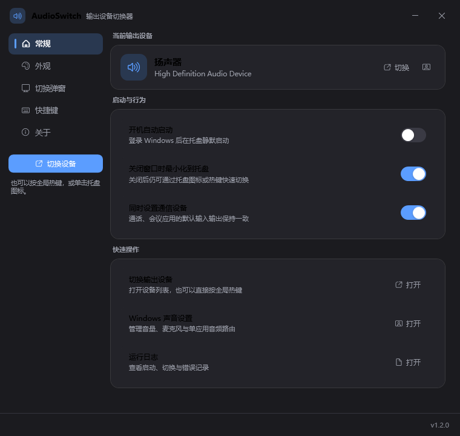
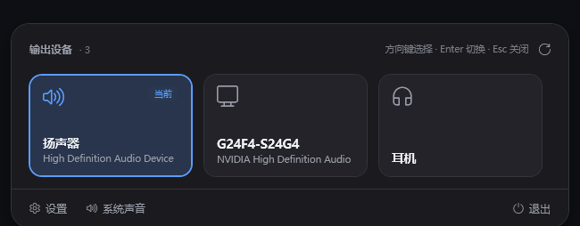
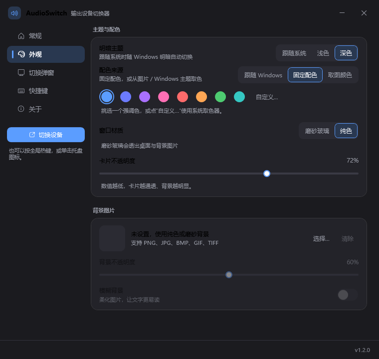
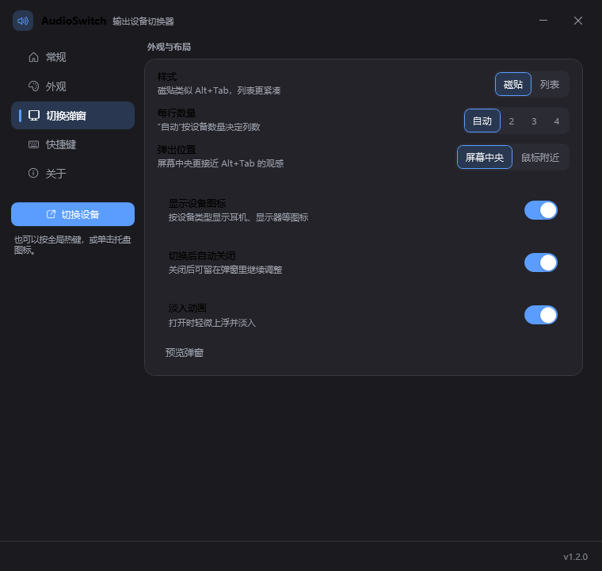
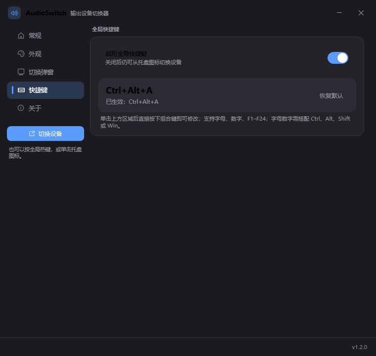
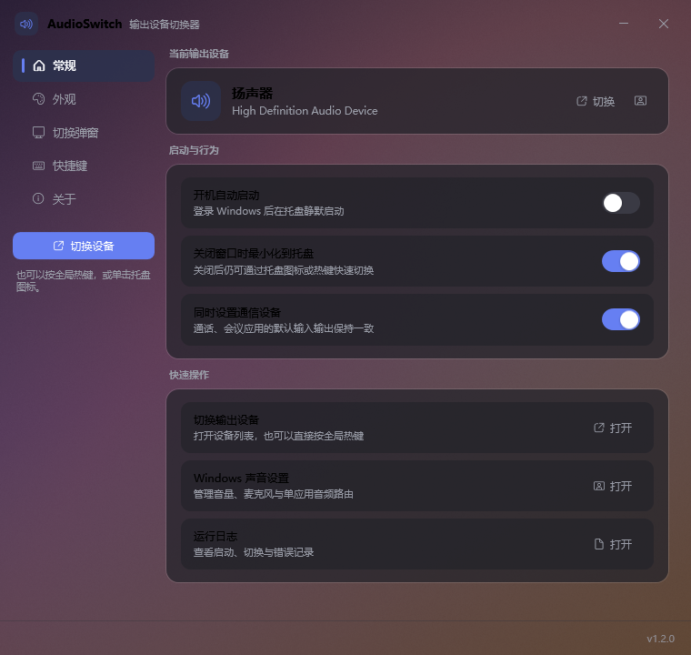
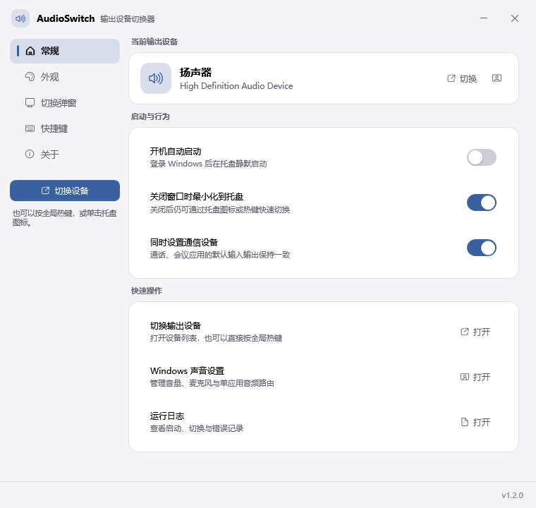
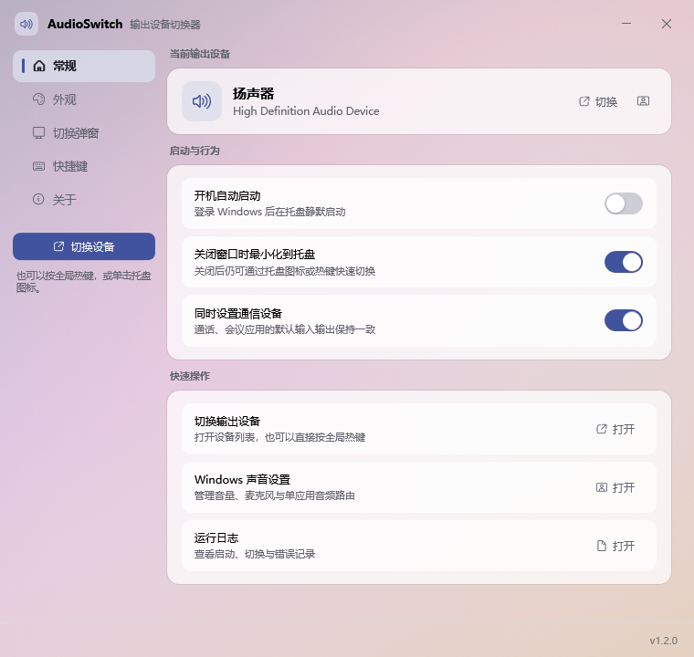
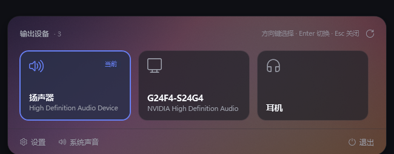
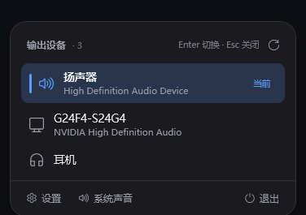

# AudioSwitch

[](https://github.com/yaanlaan/AudioSwitch/releases/latest)
[](https://github.com/yaanlaan/AudioSwitch/releases)
[](https://github.com/yaanlaan/AudioSwitch)
[](https://github.com/yaanlaan/AudioSwitch)

一个轻量的 Windows 音频输出切换工具：常驻托盘，点一下就能把系统默认输出设备切到扬声器、耳机或显示器。

*A tiny tray utility for switching the default Windows audio output device — with a Win11-style Alt+Tab picker, dark/light themes, acrylic cards and global hotkey.*

v1.2 重新设计了界面：自绘的无缝标题栏、磨砂卡片、左侧分类导航，以及类似 Win11 Alt+Tab 的磁贴式切换弹窗。

## 下载

| 方式 | 文件 | 说明 |
| --- | --- | --- |
| **安装版（推荐）** | [AudioSwitch-Setup-1.2.4.exe](https://github.com/yaanlaan/AudioSwitch/releases/latest/download/AudioSwitch-Setup-1.2.4.exe) | 按用户安装，写入开始菜单与卸载项；启动时请求一次 UAC |
| 免安装 | [AudioSwitch-Portable-1.2.4.zip](https://github.com/yaanlaan/AudioSwitch/releases/latest/download/AudioSwitch-Portable-1.2.4.zip) | 解压即用，不写注册表、不需要管理员 |
| 校验 | [SHA256SUMS.txt](https://github.com/yaanlaan/AudioSwitch/releases/latest/download/SHA256SUMS.txt) | 两个产物的 SHA-256 |

所有版本见 [Releases](https://github.com/yaanlaan/AudioSwitch/releases)。程序没有代码签名，首次运行时 Windows 可能提示「未知发布者」，原因与处理方式见下文「关于『Windows 已保护你的电脑』与 Defender」。






## 功能

- **托盘常驻**：左键或右键点击托盘图标，立刻弹出设备选择器；再次点击或按 `Esc`、点击别处即可关闭。
- **磁贴式切换器**：默认按 Alt+Tab 风格把设备排成圆角磁贴，当前设备有强调色边框和「当前」徽标；支持方向键、数字键 `1`–`9` 选择，`Enter` 切换，`Esc` 关闭。也可以切回紧凑的列表样式。
- **单击切换**：单击任意设备立即切换系统默认输出设备，切换后可自动关闭弹窗。
- **全局热键**：默认 `Ctrl+Alt+A`。设置里点一下录制框，**直接按下想要的组合键**即可生效；可随时关闭热键。
- **分类设置页**：常规 / 外观 / 切换弹窗 / 快捷键 / 关于，功能不再堆在一页。
- **一体化标题栏**：自绘标题栏与内容共用同一层背景，深色/浅色/背景图模式下都不会出现割裂的色块。
- **磨砂卡片**：选项卡片使用半透明玻璃材质，可调「卡片不透明度」，让桌面或背景图透出来。
- **明暗主题**：可选「跟随系统」「浅色」「深色」，跟随系统时随 Windows 明暗自动切换。
- **窗口材质**：Windows 11 上支持磨砂玻璃（Acrylic）或纯色；系统不支持时自动回退为纯色。
- **背景图片**：可选一张本地图片作为窗口背景，支持不透明度和模糊。
- **配色来源**：强调色可以固定选择，可以从背景图片 / 当前壁纸取色，也可以跟随 Windows 主题色。
- **通信设备同步**：可选在切换时一并设置「通信」角色，让通话、会议软件使用同一设备。
- **开机自启**：登录 Windows 后在托盘静默启动，不打扰桌面。
- **关闭到托盘**：点窗口右上角关闭时默认最小化到托盘，需要彻底退出时使用弹窗底部的「退出」。
- **单实例**：重复启动不会开出第二个进程，而是让已运行的实例弹出设备选择器。
- **高 DPI**：适配多显示器、不同缩放比例。

## 系统要求

- Windows 10 1809 及以上 / Windows 11，x64
- 安装程序会安装自包含运行时，**无需预装 .NET**
- 安装程序会请求管理员权限（UAC 确认框），用于保证文件写入不被安全策略拦截；程序仍安装在当前用户目录 `%LOCALAPPDATA%\Programs\AudioSwitch`。便携版不需要管理员
- 磨砂玻璃需要 Windows 11（22H2 及以上效果最佳），Windows 10 会使用纯色/半透明回退

## 安装（推荐）

[AudioSwitch-Setup-1.2.4.exe](https://github.com/yaanlaan/AudioSwitch/releases/latest/download/AudioSwitch-Setup-1.2.4.exe)（或其它版本 `AudioSwitch-Setup-<版本>.exe`）是按用户安装的安装程序：

1. 双击安装程序；如果 Windows 弹出 SmartScreen，点「更多信息 → 仍要运行」（**只有安装程序本身会提示**）。
2. 随后会出现 **UAC 管理员确认框**，点「是」。安装程序以管理员权限运行，避免从浏览器/聊天窗口打开时被系统限制成低权限、导致写入失败。
3. 选择安装目录（默认 `%LOCALAPPDATA%\Programs\AudioSwitch`），可选「创建桌面快捷方式」「开机自动启动」。
4. 安装完成后勾选「立即启动 AudioSwitch」。

安装程序会：

- 把程序以**普通文件夹**形式安装，不再使用单文件自解压，因此启动时不需要往 `%TEMP%` 解压运行时；
- **先解压到临时目录，再用带重试的 `robocopy` 整体复制，并校验关键文件**（1.2.4 起），避免杀毒软件瞬时锁定单个 dll 导致安装中断；
- 安装出的文件由安装程序写入，**不带「来自 Internet」标记**，之后双击 `AudioSwitch.exe` 不会再被 SmartScreen 拦截；
- 写入开始菜单、桌面快捷方式与「应用和功能」卸载项（均在当前用户范围）。

也可以静默安装（适合脚本；仍会请求管理员权限，请在管理员 PowerShell 中执行）：

```powershell
AudioSwitch-Setup-1.2.4.exe /S
AudioSwitch-Setup-1.2.4.exe /S /D=C:\Tools\AudioSwitch
```

卸载：开始菜单 → AudioSwitch → 「卸载 AudioSwitch」，或「设置 → 应用 → 已安装的应用」中找到 AudioSwitch（卸载同样会请求一次 UAC）。

> 如果你的账户不是管理员，UAC 会要求输入管理员凭据；此时安装目录会落到那个管理员账户的用户目录。这类账户建议直接使用便携版，不需要任何提权。

### 便携版

[AudioSwitch-Portable-1.2.4.zip](https://github.com/yaanlaan/AudioSwitch/releases/latest/download/AudioSwitch-Portable-1.2.4.zip) 解压即用（同样是文件夹形式，不含单文件自解压）。

解压后如果仍提示 SmartScreen，对该目录执行一次：

```powershell
Get-ChildItem -Recurse -File | Unblock-File
```

或直接使用安装程序，最省事。

## 关于「Windows 已保护你的电脑」与 Defender

发布版**没有代码签名**，从网络下载后会带上 Mark-of-the-Web，SmartScreen 会对未知发布者的程序显示蓝色提示。这是 Windows 的通用行为，不代表程序有问题。

**为什么「仍要运行」有时启动失败，而以管理员身份运行却正常？**

旧的单文件版本（`AudioSwitch.exe` 单文件发布）启动时要把 .NET 运行时解压到 `%TEMP%\.net\AudioSwitch`。这一步会被安全策略拦截，表现为提示框点了「仍要运行」却没有窗口；以管理员身份运行时权限更高，于是又能启动。**安装程序的文件夹版本不做这一步解压，因此不会有这个问题。** 如果安装程序本身也失败，最常见的原因是它以**低权限（Low Integrity）**启动——见下一节第 1 条。

如果安装后仍然无法启动，按顺序检查：

1. **Smart App Control**（Windows 11）：设置 → 隐私和安全性 → Windows 安全中心 → 应用和浏览器控制 → 智能应用控制。若为「开启」，未签名程序会被直接阻止；改为「关闭」（此设置一旦关闭需重装系统才能再开启）或使用已签名版本。
2. **Defender 拦截**：Windows 安全中心 → 保护历史记录，查看是否有 AudioSwitch 的拦截记录，选择「允许在设备上」。
3. **文件确实被锁定**：右键 exe → 属性，若底部有「解除锁定」就勾选；或在程序「设置 → 关于」点「解除文件锁定」。
4. **查看日志**：`%APPDATA%\AudioSwitch\audioSwitch.log`（如果程序能启动到写日志阶段）。
5. 仍然不行时，换一个非系统盘目录（如 `D:\Tools\AudioSwitch`）解压便携版再运行。

消除提示的长期办法只有**代码签名**（OV/EV 证书）；自签名证书对 SmartScreen 无效。

### 安装时报「无法打开要写入的文件：…\Accessibility.dll」

这是 NSIS 在写入某个 dll 时被系统拒绝（共享冲突或权限拒绝），常见原因按可能性排序：

1. **安装程序以「低权限」运行（最常见，也最容易被忽略）**：如果从浏览器/聊天软件的下载列表、下载气泡或压缩包预览里直接双击安装程序，Windows 会让它以低完整性级别（Low Integrity）启动，并把它的 `%TEMP%` 重定向到 `%LOCALAPPDATA%\Temp\Low`。**低权限进程不允许写 `%LOCALAPPDATA%`**，于是安装到一半必然失败；单文件版启动时无法在 `%TEMP%` 建目录、点「仍要运行」没反应、管理员运行却正常，也都是同一个原因。
   - 判断办法：看安装日志路径或提示里的 `%TEMP%`，如果出现 `...\Temp\Low`，就是这种情况。
   - 解决办法：**把安装程序复制到桌面（或任意普通文件夹），在文件资源管理器里双击运行**；不要从浏览器下载列表/聊天文件卡片里直接打开。
   - **1.2.4 起安装程序在程序清单里声明了「需要管理员权限」，启动时必定弹出 UAC 确认框并以管理员身份运行，因此不会再出现这种低权限情况**。如果 UAC 被组策略禁用而无法提权，请在文件资源管理器里右键 → 以管理员身份运行，或直接使用便携版。
2. **安全软件实时扫描**：Defender 或第三方杀毒会对刚写入的每个 dll 做扫描，瞬间锁住文件。安装程序会把负载先解压到临时目录，再用 `robocopy` 带 3 次重试整体复制，并做完整性校验，正常可以跨过瞬时锁定。若仍失败：
   - 换一个安装目录，例如 `D:\Tools\AudioSwitch`（不同卷、不在 AppData 下，常能避开策略）；
   - 把安装目录临时加入杀毒软件白名单，或暂停实时防护后重试；
   - 或直接解压 `AudioSwitch-Portable-<版本>.zip` 到任意文件夹使用——**不需要安装**，效果完全一样。
3. **智能应用控制（Smart App Control）**：处于「开启」时会阻止未签名的 dll/exe，安装或启动都可能失败。检查路径见上一节第 1 条。
4. **受控文件夹访问**或公司组策略：如果把 `%LOCALAPPDATA%\Programs` 划入了受保护文件夹，安装写入会被拒绝；改用公司放行的目录。
5. **旧安装残留**：之前用管理员身份安装/运行过，目录属主变成管理员，普通用户无法覆盖。可先删除 `%LOCALAPPDATA%\Programs\AudioSwitch` 再装，或换目录。
6. **程序仍在运行**：托盘里还有 AudioSwitch 时会锁定文件；安装程序现在会检测并提示先退出。

安装程序在复制前会先做**临时目录与安装目录的写入测试**，不可写时直接提示原因（而不是复制到一半失败）。日志在 `%TEMP%\AudioSwitch-install.log`（低权限环境下为 `%TEMP%\Low\...`），记录每次 robocopy 的退出码与输出。

## 使用

安装后从开始菜单或桌面快捷方式启动，程序会打开设置窗口，同时托盘出现图标。

1. 点击托盘图标（或按 `Ctrl+Alt+A`）打开设备选择器。
2. 点击目标设备（或用方向键选择后按 `Enter`）即可切换。
3. 需要修改热键、外观、弹窗布局时，在设置窗口左侧切换分类。

### 设置页

| 分类 | 内容 |
| --- | --- |
| 常规 | 当前输出设备、开机自启、关闭到托盘、通信设备同步、快速操作 |
| 外观 | 明暗主题、配色来源与色板、窗口材质、卡片不透明度、背景图片、不透明度、模糊 |
| 切换弹窗 | 磁贴/列表样式、每行数量、弹出位置、显示设备图标、切换后自动关闭、淡入动画、预览 |
| 快捷键 | 启用/关闭全局热键、录制组合键、恢复默认 |
| 关于 | 版本、配置文件与日志位置、解除文件锁定、打开日志/声音设置、SmartScreen 说明 |

### 主要设置项

| 选项 | 说明 |
| --- | --- |
| 全局热键 | 单击热键区域后直接按下组合键即可生效。支持字母、数字、`F1`–`F24` 和空格；字母与数字需搭配 `Ctrl`、`Alt`、`Shift` 或 `Win`，功能键可单独使用。被其他程序占用时会提示并保留原热键 |
| 启用全局热键 | 关闭后释放热键注册，只用托盘或设置窗口切换 |
| 主题 | `跟随系统` / `浅色` / `深色` |
| 配色来源 | `跟随 Windows`（系统主题色）、`固定配色`（内置色板或自定义颜色）、`取图片颜色`（从背景图片或当前壁纸取色） |
| 窗口材质 | `磨砂玻璃`（Windows 11 DWM Acrylic）或 `纯色` |
| 卡片不透明度 | 20%–100%，越低卡片越通透，背景图越明显 |
| 背景图片 | 选择一张图片作为窗口背景，可调不透明度（20%–100%）、可模糊；「清除」恢复默认 |
| 弹窗样式 | `磁贴`（Alt+Tab 风格大卡片）或 `列表`（紧凑单列） |
| 每行数量 | 磁贴样式下的列数：`自动`（按设备数量决定）或 2/3/4 |
| 弹出位置 | `屏幕中央`（鼠标所在显示器的中央，更接近 Alt+Tab）或 `鼠标附近`（在光标上方弹出） |
| 显示设备图标 | 按设备类型显示耳机、显示器、扬声器等图标 |
| 切换后自动关闭 | 关闭后可以在弹窗里继续切换其它设备 |
| 淡入动画 | 打开时轻微上浮并淡入 |
| 开机自动启动 | 写入当前用户的 `HKCU\Software\Microsoft\Windows\CurrentVersion\Run`，以 `--tray` 参数静默启动 |
| 关闭窗口时最小化到托盘 | 关闭时隐藏窗口而不是退出程序 |
| 同时设置通信设备 | 切换时把 `eCommunications` 角色也切换到同一设备 |

强调色会在明暗主题下自动调整明度与饱和度，避免 Windows 主题色过暗导致看不清。

### 外观预览

| 深色 · 常规 | 深色 · 外观 |
| --- | --- |
|  |  |

| 深色 · 切换弹窗设置 | 深色 · 快捷键 |
| --- | --- |
|  |  |

| 深色 · 纯色 | 深色 · 背景图 |
| --- | --- |
|  |  |

| 浅色 · 纯色 | 浅色 · 背景图 |
| --- | --- |
|  |  |

| 磁贴弹窗 · 背景图 | 列表弹窗 |
| --- | --- |
|  |  |

更多截图见 [`docs/appearance`](docs/appearance)。

### 数据与日志

- 设置：`%APPDATA%\AudioSwitch\settings.json`
- 日志：`%APPDATA%\AudioSwitch\audioSwitch.log`（超过 1 MB 时轮转为 `.1`）

设置窗口的「关于」页和弹窗底栏都可以直接定位日志文件或打开系统声音设置。

## 命令行

发布版支持无人值守操作，便于脚本或排障：

```powershell
# 列出所有输出设备及当前默认设备
AudioSwitch.exe --probe

# 按序号、设备 ID 或名称片段切换（默认同时设置三个角色）
AudioSwitch.exe --switch 2
AudioSwitch.exe --switch 耳机
AudioSwitch.exe --switch "{0.0.0.00000000}.{...}"

# 只修改指定角色
AudioSwitch.exe --switch 扬声器 --roles console,multimedia
AudioSwitch.exe --switch 耳机 --roles communications

# 自检：切换到另一台设备、校验、再还原，退出码 0 表示通过
AudioSwitch.exe --self-test

# 验证热键组合能否解析并真正注册（退出码 0/1）
AudioSwitch.exe --hotkey-test "Ctrl+Shift+F9"
AudioSwitch.exe --hotkey-test "F8"

# 查看系统主题、强调色、壁纸取色与 DWM 磨砂是否可用
AudioSwitch.exe --theme-info

# 托盘静默启动（供开机自启使用）
AudioSwitch.exe --tray
```

`--probe` 输出形如：

```text
DEVICE|{0.0.0.00000000}.{...}|扬声器|High Definition Audio Device|1|console,multimedia
DEVICE|{0.0.0.00000000}.{...}|耳机||3|communications
DEFAULT|console|{0.0.0.00000000}.{...}
DEFAULT|multimedia|{0.0.0.00000000}.{...}
DEFAULT|communications|{0.0.0.00000000}.{...}
END|3
```

`--theme-info` 输出形如：

```text
SYSTEM|dark|accent=#072128|wallpaper=...|build=26300|mica=1|backdrop=1
SETTINGS|theme=system|color=system|accent=#5B9DFF|material=acrylic|opacity=0.55|blur=1|background=-
SAMPLE|...|accent=#09232B|avg=#09232B|luminance=0.12|fallback=0
BACKDROP|acrylic|OK|backdrop=acrylic
```

## 从源码构建

需要 .NET 9 SDK（Windows）：

```powershell
dotnet build AudioSwitch.sln -c Release
```

运行调试版：

```powershell
dotnet run --project src\AudioSwitch\AudioSwitch.csproj
```

开发期离屏渲染（无需可见桌面即可检查界面）：

```powershell
# 当前主题下的设置窗口与弹窗
AudioSwitch.exe --render all shots

# 深/浅 × 纯色/背景图，外加各功能页与磁贴/列表弹窗，共 13 张
AudioSwitch.exe --render-all docs\appearance --bg docs\wallpaper.png
```

### 生成安装程序与便携版（推荐）

```powershell
pwsh -File scripts\build-installer.ps1
```

脚本会：结束正在运行的实例 → 发布文件夹版本到 `build\app` → 打包便携版 zip → 下载 NSIS（首次）→ 编译安装程序。

产物：

- `dist\AudioSwitch-Setup-<版本>.exe`（约 46 MB，会请求 UAC，按用户安装）
- `dist\AudioSwitch-Portable-<版本>.zip`（约 66 MB，解压即用）

安装程序用 NSIS 编写（[installer/installer.nsi](installer/installer.nsi)），安装到 `%LOCALAPPDATA%\Programs\AudioSwitch`，写入开始菜单/桌面快捷方式与当前用户的卸载项。

### 单文件版本

```powershell
# 脚本会先结束正在运行的实例，并删除 pdb
pwsh -File scripts\publish.ps1
```

产物：`dist\AudioSwitch.exe`（自包含单文件，约 65 MB）。

> 单文件首次启动会解压运行时到 `%TEMP%\.net\AudioSwitch`，冷启动约 1 秒。部分安全策略会拦截这一步，导致双击后没有窗口——**这种情况请改用安装程序或便携版**。需要继续用单文件时，可设置环境变量 `DOTNET_BUNDLE_EXTRACT_BASE_DIR` 指向可写目录。

## 实现原理

- 通过 Core Audio COM 接口 `IMMDeviceEnumerator` 枚举 `eRender` 端点，读取 `PKEY_Device_FriendlyName`、`PKEY_Device_DeviceDesc`、`PKEY_DeviceInterface_FriendlyName` 和 `PKEY_AudioEndpoint_FormFactor` 生成显示名与图标。
- 通过 Windows 未公开接口 `IPolicyConfig::SetDefaultEndpoint`（CLSID `870AF99C-171D-4F9E-AF0D-E63DF40C2BC9`）分别设置 `eConsole`、`eMultimedia`、`eCommunications` 三个角色的默认端点。
- 主题由 `ThemeService` 统一计算：明暗取 `AppsUseLightTheme`，系统强调色取 `DwmGetColorizationColor`，图片取色把图片缩到 64px 后按饱和度加权统计主色，再按背景明暗调整 HSV。
- 设置窗口用 `WindowChrome` 自绘标题栏，`TintLayer / BackgroundImageLayer / ScrimLayer` 三层铺满整窗，卡片使用带透明度的 `GlassBrush`，因此标题栏、内容与背景图是同一块材质。
- 磨砂使用 DWM 的 `DWMWA_SYSTEMBACKDROP_TYPE`（Windows 11 22H2+）或 `SetWindowCompositionAttribute` 的 Acrylic 模糊，失败时逐级回退并写入日志。
- 设备选择器用 `WrapPanel` + 自定义 `ListBoxItem` 模板渲染磁贴，列数由设置或设备数量决定，窗口尺寸随内容计算。
- 全项目零 NuGet 依赖，COM 互操作全部手写，托盘使用 WinForms `NotifyIcon`，热键使用 `RegisterHotKey`。

## 项目结构

```text
src/AudioSwitch/
  Interop/        Core Audio、IPolicyConfig、DWM 与 Win32 互操作
  Audio/          设备枚举、默认设备读写
  Services/       设置、日志、开机自启、单实例、命令行
  Ui/             主题服务、调色板、背景图、托盘、热键、弹窗与设置窗口
  Assets/         应用图标
tools/              图标与示例壁纸生成脚本（Pillow / numpy）
scripts/publish.ps1 单文件发布脚本
scripts/build-installer.ps1 安装程序与便携版打包脚本
installer/installer.nsi NSIS 安装脚本
docs/appearance/    外观预览图
```

## 已知限制

- 只管理系统**默认输出设备**，不处理单个应用的音频路由、音量或麦克风。
- 依赖 Windows 未公开的 `IPolicyConfig` 接口，系统大版本升级后若行为变化需要更新。
- 设备列表来自 `DEVICE_STATE_ACTIVE` 端点，已禁用的设备不会显示。
- 磨砂玻璃依赖 DWM；在远程桌面、关闭「透明效果」或旧版 Windows 上会回退为纯色。
- 背景图片仅用于窗口装饰，不做任何图像处理（缩放/模糊在内存中完成，不回写文件）。
- 未做代码签名：安装程序首次运行可能触发 SmartScreen；安装后的程序不带网络标记，通常不会再提示。若系统开启了 Smart App Control，未签名程序仍可能被阻止，只能关闭该功能或使用签名版本。

## 排查

- **双击后没有窗口**：多半是旧的单文件自解压版本被安全策略拦截，改装 `AudioSwitch-Setup` 或便携版；细节见上文「关于 Windows 已保护你的电脑与 Defender」。
- 出现 SmartScreen 提示：安装程序只需点一次「仍要运行」；便携版可对目录执行 `Unblock-File`，或在「关于」页一键解除。
- 热键无效：多半被其它程序占用（设置窗口会提示并保留旧热键），换一个组合即可；也可用 `--hotkey-test` 单独验证。
- 磨砂没有效果：确认系统为 Windows 11 且「设置 → 个性化 → 颜色 → 透明效果」已开启；`--theme-info` 会显示 `BACKDROP` 的结果与 HRESULT。
- 背景图不显示：图片移动或删除后设置会自动回退为纯色；重新选择一次即可。
- 磁贴列数不对：把「每行数量」设为固定值，或调整窗口所在显示器的缩放。
- 切换后没有声音：确认目标设备已连接且在「系统声音」中处于启用状态。
- 遇到异常：查看 `%APPDATA%\AudioSwitch\audioSwitch.log`，或在设置窗口点「打开日志」。


## 更新记录

- **1.2.4** — 安装程序声明 
equireAdministrator，启动即请求 UAC，彻底避免低权限导致的写入失败；安装前做写入测试，失败时给出可操作提示。
- **1.2.3** — 检测低完整性级别（...\Temp\Low）环境，提示以管理员身份重启安装。
- **1.2.2** — 负载先解压到临时目录，再用带重试的 
obocopy 整体复制并校验关键文件，避免单个 DLL 被安全软件瞬时锁定。
- **1.2.1** — 新增 NSIS 安装程序与便携版 zip。
- **1.2.0** — 界面重构：无缝标题栏、磨砂卡片、左侧分类设置页、Alt+Tab 磁贴弹窗及外观参数、SmartScreen 一键解除。
- **1.1.0** — 热键按下即录制、明暗主题、磨砂玻璃、背景图片、配色三来源。
- **1.0.0** — 托盘常驻、全局热键、设备切换弹窗、命令行自检。

## 反馈与贡献

- 问题反馈、功能建议：[Issues](https://github.com/yaanlaan/AudioSwitch/issues)
- 提交代码前建议运行：

  `powershell
  dotnet build AudioSwitch.sln -c Release
  src\AudioSwitch\bin\Release\net9.0-windows\AudioSwitch.exe --self-test
  `

- 界面改动可以用 --render-all docs\appearance --bg docs\wallpaper.png 生成全部截图后再提交。